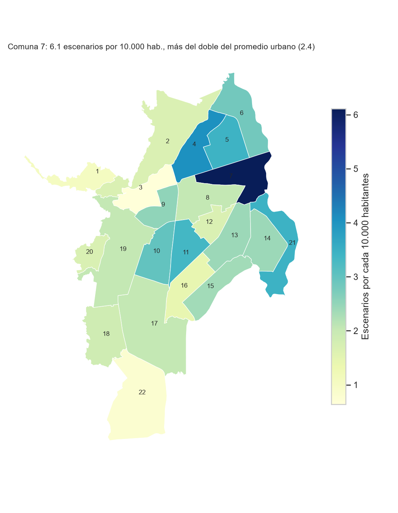
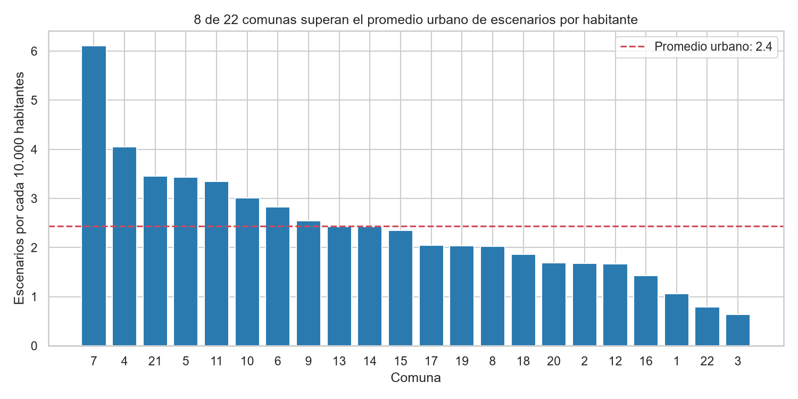
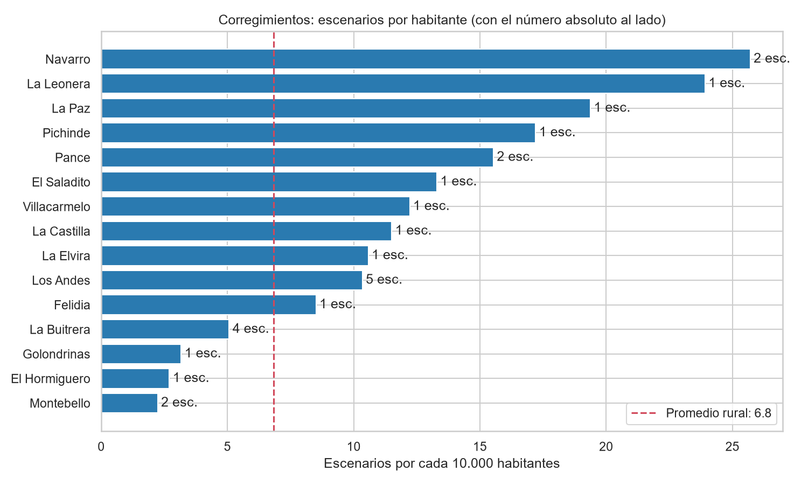

# Escenarios deportivos y recreativos por habitante en Santiago de Cali

Análisis exploratorio con datos abiertos de la Alcaldía de Cali para responder una pregunta simple: **¿qué comunas y corregimientos tienen más y menos oferta de escenarios deportivos y recreativos en relación con su población?**

Contar escenarios no basta para comparar territorios, porque una zona con más habitantes necesita más infraestructura. Por eso este proyecto calcula **escenarios por cada 10.000 habitantes** y lo contrasta con rankings, análisis por número de instalaciones y mapas.



## Hallazgos principales

- El inventario tiene **617 escenarios**: 592 en las 22 comunas urbanas y 25 en los 15 corregimientos rurales.
- El promedio urbano es de **2,4 escenarios por cada 10.000 habitantes**.
- La **comuna 7 lidera con 6,1** (más del doble del promedio) y la **comuna 3 queda última con 0,64**. La brecha entre ambas es de unas **9,5 veces**.
- **Normalizar por población cambia el panorama:** la comuna 6 es la que más escenarios tiene en total (56), pero baja al puesto 7 por habitante (2,8) porque también es la más poblada.
- Solo 8 de las 22 comunas superan el promedio urbano; las otras 14 quedan en él o por debajo.
- Cuatro tipos de escenario (parque recreativo, polideportivo, cancha múltiple y cancha) concentran cerca del **76 %** de la oferta.
- Las instalaciones más comunes son las canchas múltiples (~55 % de los escenarios) y los juegos infantiles (~52 %). Las piscinas están en cerca del 7 %.
- **Prueba de robustez:** al repetir el cálculo con el total de instalaciones en lugar del número de escenarios, la correlación de Spearman entre ambos rankings es de **0,79**. La comuna 7 sigue primera y la 3 última, pero algunas cambian bastante: la comuna 9 pasa del puesto 8 al 20, lo que indica que tiene escenarios más sencillos.
- **Zona rural:** los 15 corregimientos suman 25 escenarios para 36.648 habitantes (proyección 2020), es decir, **6,8 por cada 10.000** (casi el triple del promedio urbano), y todos tienen al menos uno. Sin embargo, el promedio esconde mucha variación: los valores más altos son de corregimientos muy pequeños con 1 o 2 escenarios (Navarro: 25,7; La Leonera: 23,9; La Paz: 19,4; todos con menos de 800 habitantes), mientras que los más poblados quedan cerca del promedio urbano (Montebello: 2,2; El Hormiguero: 2,7; Golondrinas: 3,2).
- **Instalaciones en zona rural:** al medir por número de instalaciones, la ventaja rural casi desaparece (**≈6,3 frente a ≈5,9 por cada 10.000 habitantes**), porque los escenarios rurales reportan menos instalaciones (menos de 1 por escenario frente a unas 2,4 en la zona urbana).





## Datos

| Fuente | Uso | Enlace |
|---|---|---|
| Escenarios deportivos de Santiago de Cali (Datos Abiertos de Cali) | Inventario de escenarios con comuna, barrio, tipo e instalaciones | [Portal](https://datos.cali.gov.co/en/dataset/escenarios-deportivos-de-santiago-de-cali/resource/de4a23e6-2440-47ec-bdc1-cac61c5f2ad8) |
| Proyecciones de población de Cali 2006–2020 (Planeación Municipal) | Población por comuna y corregimiento (corte 2020) | [Portal](https://datos.cali.gov.co/en/dataset/proyecciones-de-poblacion-de-cali-por-comuna-y-corregimiento-2006-2020/resource/63f3e50e-0452-49cf-993d-08dfc2842cb4) |
| Límites territoriales DIVIPOLA 2026 (IDESC, Alcaldía de Cali) | Geometrías de comunas y corregimientos para los mapas | [Página](https://www.cali.gov.co/planeacion/publicaciones/172941/datos-divipola-idesc/) |

## Metodología

1. **Exploración y limpieza:** estandarización de nombres de columnas (corrigiendo caracteres dañados), normalización de texto, imputación de 27 nulos en `tipo_espacio` como `"Sin dato"`, eliminación de la columna sin variación (`futsala`) y verificación de duplicados (no hay).
2. **Separación urbano/rural:** la columna `comuna` mezcla códigos del 1 al 22 (comunas) y del 51 al 65 (corregimientos). Se creó una columna `zona`.
3. **Población:** se tomaron las 22 comunas y los 15 corregimientos de las proyecciones 2020, excluyendo las filas de totales.
4. **Indicador y cruce espacial:** cálculo de `(escenarios / población 2020) × 10.000` y unión con las capas geográficas de DIVIPOLA verificando que todos los códigos coincidan.
5. **Robustez:** recálculo del ranking usando el total de instalaciones y comparación con la correlación de Spearman.
6. **Visualización:** gráficos estáticos en `reports/figures/` y mapa interactivo en `reports/mapa_escenarios.html`.

## Limitaciones

- La población es una **proyección a 2020** y el inventario de escenarios no especifica una fecha exacta de corte.
- Cada fila cuenta como un escenario, sin distinguir tamaño, calidad ni estado de conservación.
- El indicador es **por comuna y corregimiento, no por barrio**: dentro de una misma comuna puede haber zonas sin oferta.
- No mide accesibilidad real (distancias o transporte) y no se verificó si el inventario incluye escenarios privados o de clubes.
- En la población urbana hay una categoría `"Otros"` (34.714 personas en 2020) sin comuna asignada que se excluyó del cálculo.
- Los resultados son **descriptivos**: muestran brechas, pero no explican sus causas.
- En los corregimientos la población es pequeña y el indicador es muy sensible: un solo escenario cambia bastante la tasa, y al estar las viviendas dispersas un escenario puede quedar lejos de buena parte de la población.
- En cuatro corregimientos (La Paz, La Castilla, La Elvira y Felidia) el único escenario registrado reporta cero instalaciones, así que medir por escenarios o por instalaciones cuenta historias distintas.

## Cómo reproducirlo

```bash
git clone https://github.com/Sant1833/Cali_escenarios_deportivos.git
cd Cali_escenarios_deportivos
python -m venv .venv
.venv\Scripts\activate        # Mac/Linux: source .venv/bin/activate
pip install -r requirements.txt
```

Abre y ejecuta los notebooks de `notebooks/` en orden (`01` al `04`). Los datos originales están en `data/raw/` y los procesados se guardan en `data/clean/`.

## Estructura

```text
Cali_escenarios_deportivos/
├── data/
│   ├── raw/                        # DIVIPOLA_2026.gdb, escenarios_deportivos.csv, poblacion_comunas.csv
│   └── clean/                      # Datos limpios y tablas resultantes
├── notebooks/
│   ├── 01_exploracion.ipynb        # Limpieza y revisión inicial
│   ├── 02_analisis.ipynb           # Estadísticas, tipos de escenario y robustez
│   ├── 03_poblacion_mapa.ipynb     # Cruce con población y mapas
│   └── 04_graficos_finales.ipynb   # Gráficos finales
├── reports/
│   ├── figures/                    # Gráficos y mapa usados en este README
│   └── mapa_escenarios.html        # Mapa interactivo
├── src/                            # Scripts auxiliares
├── requirements.txt
└── README.md
```

## Tecnologías

Python · pandas · geopandas · scipy · matplotlib · seaborn · Jupyter · Git

## Autor

Santiago Garcia
